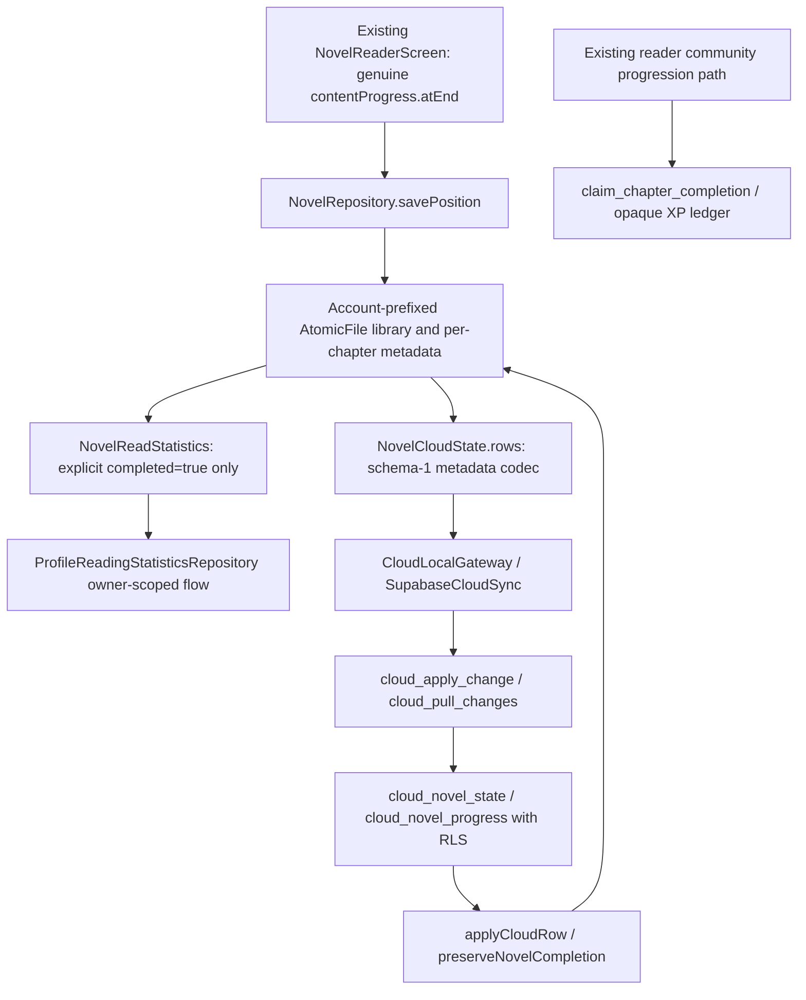

# Novel completion evidence and historical statistics

Production contract inspected read-only on 2026-10-21, project
`pehsxthjetlltlsqcbfa`, PostgreSQL 17.11. **No deployment or historical backfill.**

## Actual existing architecture

The novel format is explicit in source IDs and these two novel-only tables.
Edition key = SHA-256 of `source_id:work_url`; chapter key = SHA-256 of exact
chapter URL inside that edition. No chapter numbers, titles or Atlas work
grouping establish chapter equivalence. Comic progress has its separate
cloud_chapter_progress table and local SQLDelight is_read semantics.

The genuine reader-end path stores nullable `completed` in local positions.
Null in legacy files means unknown, not false. True survives rereading and
schema-1 cloud restoration through preserveNovelCompletion. The schema-1
validator allows chapter/paragraph/offset/updatedAt/anchor, excludes completed;
the compatibility codec deliberately strips it. Progress and bookmarks sync,
but a fresh device cannot recover completion proof which never reached cloud.

The public profile_own_statistics RPC aggregates social counts, not authoritative
historical reading. reader_chapter_completions is an owner-private XP ledger of
opaque hashes without explicit novel/comic format. In the existing novel reader,
the community progression submission occurs around two-thirds of visible blocks,
whereas local completed=true requires genuine end. **That ledger cannot be
reclassified as end-of-chapter history.** This task preserves XP rules and never
replays its events to award XP or manufactures completion from them.

## Proven client defects corrected

1. NovelCloudState previously appended the library's lastPosition to persisted
   per-chapter snapshots and used associateBy (last wins). A stale pointer could
   overwrite a newer disk position in the cloud payload. Coalescing now selects
   the greatest updatedAt for position while preserving explicit true evidence
   from any snapshot of that exact chapter. This preserves deliberate newer
   backwards reading, rather than selecting a highest paragraph/chapter number.
2. Statistics previously keyed `(source, work URL, chapter URL)`. Duplicate legacy
   work pointers could count the identical source chapter twice. The projection
   now keys `(source, exact chapter URL)`. Different providers remain independent.

No persistence format, source ID, chapter ID, cloud schema-1 payload shape,
reader mechanics, XP call site, privacy policy or profile layout changes.
The two edited legacy Kotlin files are fully formatted and their exact-content
exemptions deliberately retired with reasons. All other baseline hashes remain.

## Evidence classification

| Existing evidence | Treatment |
| --- | --- |
| Owner-scoped local position with completed=true | Count once by exact source-qualified chapter identity |
| Legacy position without completed | Unknown; retain position, do not infer read count |
| completed=false | Exclude from completed total |
| Same chapter's null/false plus explicit true | Preserve true, latest position separately |
| Highest chapter, scroll offset, chapter available/downloaded | Not completion evidence |
| Work readingStatus=completed | Work-level user selection, not per-chapter proof |
| XP ledger entry or XP amount | Not sufficient proof of format or genuine chapter end |
| Another account's metadata | Never import implicitly or count |

Data genuinely missing from both local files and cloud cannot be reconstructed.
No production records were queried, so this report makes no per-user claim about
recoverable counts. Explicit guest import remains the existing opt-in merge;
guest files and their identity/ownership rules are untouched.

## Separately reviewed proposed server enhancement

`proposals/novel-completion-evidence-v2.sql` is executable in disposable tests,
**not a deployed migration**. It is deliberately separate from Mknov:

- Retains the original validator and adds a wrapper validating optional
  boolean/null completed before delegating all original checks.
- Replaces only the two state CHECK validator references; existing state field,
  size, URL and metadata checks remain. No table or RLS changes.
- Preserves true per-chapter evidence on updates from old clients which omit it,
  send null, or reread with false; position/bookmark updates still work.
- Keeps schema=1/private/tables exactly compatible and adds completionEvidence=1.
- Adds owner-only, no-user-argument aggregate RPC. It does not expose history to
  public profiles. Exact `(source_id,chapter_url)` deduplication remains distinct
  from comic/manhwa progress. No XP functions/triggers are called.
- Tombstones hide removed progress from active counts while retaining recoverable
  proof in the existing private row; stale revisions cannot resurrect it. This
  is explicit history visibility, not destructive deletion or library clearing.
- Reports historicalComplete=false even when confirmedReadChapters=0. The confirmed
  count is exact for observed active evidence, not a complete all-time total.

Both proposals have 5s lock/30s statement bounds. The completion proposal needs
its own production schema/lock/backup review and explicit deployment approval;
Mknov approval must not implicitly authorize it. No backfill is included.

## Client activation contract still required before deployment

The production client intentionally remains schema-1: it does NOT send completed
or call the proposed aggregate today. Do not enable a new field before server
capability negotiation, or claim this proposal already fixes cross-device totals.
A subsequent reviewed activation must:

1. Bind the advertised completion capability to the current account/session;
   invalidate it on logout/switch/failed probe. Old servers keep current behavior.
2. Send true only from durable genuine reader-end local evidence using the
   existing metadata/dirty snapshot path. Never derive it from XP, chapter order,
   downloads, or a restored null position.
3. Pull existing progress rows through the same revision cursors, union local and
   remote explicit evidence by source-qualified chapter, and preserve true under
   conflict and old-client writes. Do not add a server count to a local count:
   that would double-count overlapping chapters.
4. Keep historical completeness partial unless actual evidence establishes it.
   An empty synchronized response alone cannot prove an account's missing past.
5. Never replay restored events through claim_chapter_completion. XP is unchanged.

This activation is intentionally not merged under an unapproved database contract.
There is no second repository, database or XP engine.

## Verification and honest scope

`NovelCompletionEvidenceTest` exercises stale snapshot delivery, retries,
idempotency, both device orders, legacy restoration, same-source duplicate work
pointers, distinct providers/chapters, no invented counts and separate account
projections. Existing account/workspace, guest merge, cloud ownership and profile
tests remain required; pure projection tests alone do not prove OAuth sessions.

`supabase/tests/validate_novel_completion_contract.py` runs the proposal against
PostgreSQL 17.11 with synthetic roles/accounts: schema-1 rejection, preserved URL
validation/RLS/grants, idempotency, no inferred history, old-client omission/null/
false preservation, revisions and lost acknowledgement, A→B→A, anonymous/missing
identity rejection, spoofed owner rejection, invalid types/content, independent
chapters/providers, tombstones and partial historical status. A synthetic XP
sentinel is unchanged; it is not a simulation of all production XP rules.

The application regression suite and current CI results are recorded separately
from SQL fixture counts in the Downloads report. No phone installation, APK
production, production data write or profile-number fabrication occurs here.

`MknovCloudRetryContractTest` additionally uses the real Supabase Kotlin SDK,
production `SupabaseCloudSync.syncNow`, and actual `NovelCloudState` payloads
against a loopback HTTP contract server. A 23514 source CHECK response retains
both pending rows and reports failure without a success timestamp. After the
server contract is corrected, a new coordinator instance replays the same
preserved journal, clears retry/error state and synchronizes the exact edition/
chapter without reset or XP calls. A third sync is idempotent. The journal is a
memory-backed fixture, not a claim of physical SQLite/process-death acceptance;
the separate PostgreSQL suite tests the real database/API/RLS behavior.

Status: safe local projection fixes implemented; server completion contract tested
as a proposal; authoritative cross-device all-time history remains unavailable.
